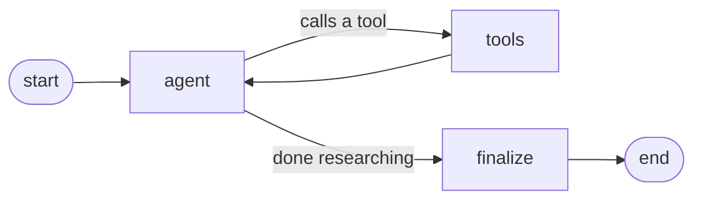

# Competitive Analysis Agent

An AI agent that researches the main competitors in a product category and builds a **messaging map**: each competitor's positioning statement, the messaging pillars they lead with, the exact claims on their website and the white space no one is claiming.

## Why I built this

After finishing DeepLearning.AI's [AI Agents in LangGraph](https://www.deeplearning.ai/courses/ai-agents-in-langgraph) course, I got way too excited and wanted to put everything I'd learned to work on a real problem. As a marketer, I didn't have to look far. Some of my work could be simpler with an agent doing the legwork.

Take competitive analysis. Before I can say my product is the better choice, I need to know who I'm up against, what they're telling buyers and how that story is shifting over time. Doing that by hand means visiting site after site, copying claims into a doc and starting over every time someone updates their homepage. Competitive intelligence platforms like Klue and Crayon already do this well but I wanted to understand how a tool like that might work under the hood. So I built a small version myself.

You give it a category ("vector databases", "coffee chains") and it finds the players, checks the list with you, reads their websites and hands back a structured report. Run it again later and it tells you what changed.

## Example output

From a real run on `"vector databases"` (Pinecone, Weaviate and Redis; Pinecone and some rows left out for length):

> ### Redis
> **Positioning statement:** The world's fastest vector database
>
> | Messaging pillar | Claim (Verbatim Copy) | Claim (Summary) | Source |
> |---|---|---|---|
> | Speed and real-time performance | "Leverages our in-memory architecture for ultra-low-latency vector queries." | Redis attributes low-latency vector queries to its in-memory architecture. | redis.io/solutions/vector-database |
> | Hybrid and flexible retrieval | "We offer a full suite of both vector search and exact match capabilities with Redis Query Engine so you can search the way you want." | Redis combines vector search and exact-match search to support different retrieval needs. | redis.io/solutions/vector-database |
> | Developer ecosystem and integrations | "We partner with top agent tools like LangChain and LlamaIndex to make building GenAI apps easier." | Redis highlights integrations with agent-development frameworks as a way to simplify building GenAI apps. | redis.io/solutions/vector-database |
>
> ### Weaviate
> **Positioning statement:** Design, build and ship complete AI experiences
>
> | Messaging pillar | Claim (Verbatim Copy) | Claim (Summary) | Source |
> |---|---|---|---|
> | Combined search and AI capabilities | "Vector search, RAG, and memory - all in one open-source platform." | Weaviate combines vector search, RAG, and memory in an open-source platform. | weaviate.io |
>
> ### White space
> - **Offer transparent, comparable performance benchmarks across representative buyer workloads**: Redis claims to be the fastest and Pinecone promises fast performance at scale, but the fetched pages do not provide a common, buyer-ready basis for comparing performance.
> - **Explain migration and adoption alongside existing data systems**: none of the fetched pages clearly claims a simple migration path or describes how the product fits into a buyer's existing data stack.

## How it works



1. **Agent (ReAct loop).** The model reasons about what to do next and calls tools until every competitor has claims:
   - `web_search`: finds the main players in the category (Tavily).
   - `confirm_competitors`: **pauses and asks you** to approve the list before any pages are read (human in the loop).
   - `fetch_page`: reads a competitor's homepage or "why us" page (Tavily Extract, with a plain HTTP fallback).
   - `get_previous_map`: loads the last saved map for this category, to spot changes.
2. **Finalize.** One structured-output step turns the research into a validated `MessagingMap` (Pydantic) so the result always has the same shape. The map is saved for the next run.

**Memory.** Two SQLite files are created next to the script on first run:
- `checkpoints.db`: every step of every run, by thread ID. Used to pause, resume and replay a run with `--inspect`.
- `store.db`: the latest map per category. Used for "changes since last run".

## Setup

Requires **Python 3.12**.

```bash
python3.12 -m venv .venv
source .venv/bin/activate
pip install -r requirements.txt
```

Create a `.env` file in this folder with your API keys:

```
OPENAI_API_KEY=...
TAVILY_API_KEY=...
```

## Usage

```bash
# Run the agent on a category (use a new thread ID for every run)
python competitive_analysis_agent.py "vector databases" --thread vdb-1

# Replay what the agent did in a past run, step by step (runs nothing, costs nothing)
python competitive_analysis_agent.py --inspect vdb-1

# Show all options
python competitive_analysis_agent.py --help
```

During a run, the agent stops to show the competitors it found:

```
Proposed competitors:
  0: Pinecone: https://www.pinecone.io/
  1: Weaviate: https://weaviate.io/
  2: Qdrant: https://qdrant.tech/
Indexes to remove (comma-separated, blank = keep all): 2
```

To track messaging over time, run the same category again later with the **same competitors** and a **new thread ID**. The report's "Changes since last run" section lists what moved.

### Using it from Python

```python
from competitive_analysis_agent import run, show_map

m = run("vector databases", thread_id="vdb-2")   # returns a MessagingMap
show_map(m)                                       # readable report
data = m.model_dump()                             # plain dict, for other code
```

## Output structure

```
MessagingMap
├── category
├── competitors[]
│   ├── name, url
│   ├── positioning_statement        homepage headline, copied word for word
│   └── claims[]
│       ├── messaging_pillar
│       ├── claim_verbatim           copied word for word from the page
│       ├── claim_summary            one line, in plain English
│       └── source_url               every claim has a source
├── messaging_pillars[]              which competitors claim each pillar
├── white_space[]                    angles no competitor clearly claims
└── changes_since_last_run[]
```

## Settings

All tunable values are at the top of `competitive_analysis_agent.py`:

| Setting | Default | What it controls |
|---|---|---|
| `MODEL_NAME` | `gpt-6-luna` | OpenAI model used for research and the final map |
| `SEARCH_MAX_RESULTS` | 5 | Results per web search |
| `MAX_PAGE_CHARS` | 6000 | Characters kept per fetched page |
| `RECURSION_LIMIT` | 40 | Safety cap on steps per run |

## Limitations

- **Verbatim claims are not checked automatically.** The model is instructed to copy claims word for word and every claim has a source URL. But nothing verifies the text against the page, so spot-check important claims.
- **"Changes since last run" is written by the model.** It may report rewording (a pillar named differently) as a change even when the website did not change.
- **Pages are cut to 6,000 characters** so claims far down a long page can be missed. Some JavaScript-heavy sites return little usable text.
- **Reusing a thread ID adds to the old run** instead of starting fresh. Use a new thread ID for every run.

## Files

| File | What it is |
|---|---|
| `competitive_analysis_agent.py` | The agent: run it from the terminal or import it |
| `competitive_analysis_agent.ipynb` | Notebook version of the agent |
| `requirements.txt` | Pinned dependencies |

Built with [LangGraph](https://github.com/langchain-ai/langgraph), [LangChain OpenAI](https://python.langchain.com/), [Tavily](https://tavily.com/) and [Pydantic](https://docs.pydantic.dev/).
